<p align="center">
  <picture>
    <source media="(prefers-color-scheme: dark)" srcset="docs/images/logo-animated-dark.svg">
    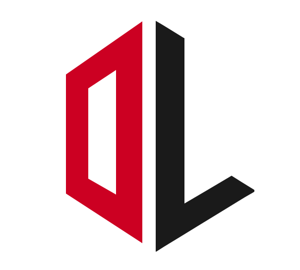
  </picture>
</p>

<p align="center">
  <picture>
    <source media="(prefers-color-scheme: dark)" srcset="docs/images/wordmark-dark.svg">
    
  </picture>
</p>

<p align="center">
  <a href="https://readme-typing-svg.demolab.com">
    
  </a>
</p>

<p align="center"></p>

<p align="center">
  <sub>Built by</sub><br/>
  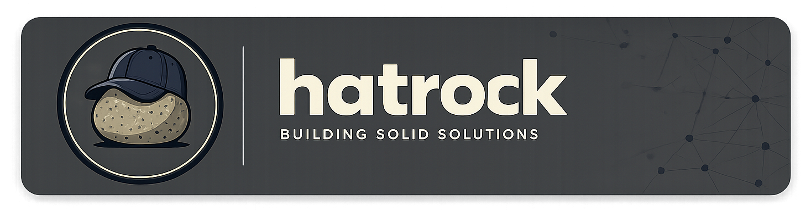
</p>

<div align="center">

[](https://github.com/COS301-SE-2026/OptiLifts/actions)
[](https://github.com/COS301-SE-2026/OptiLifts)
[](https://github.com/COS301-SE-2026/OptiLifts/issues)
[](https://github.com/COS301-SE-2026/OptiLifts/commits/main)
[](https://stats.uptimerobot.com/65K4aFGFCx)

<br>

[](https://app.optilifts.app/)


</div>

<p align="center"></p>

##  Demo

<div align="center">

<h3>OptiLifts Trailer</h3>

<a href="https://youtu.be/TRAILER_ID">
  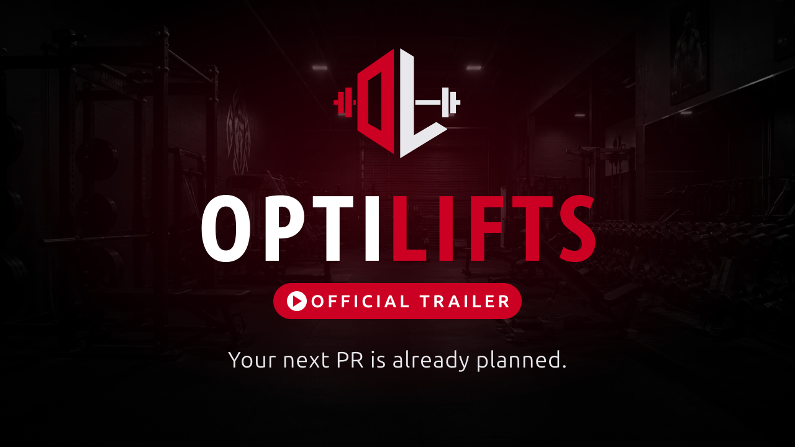
</a>

<br><br>

<h3>Full Demo</h3>

<a href="https://youtu.be/pJrY7ZA-akw">
  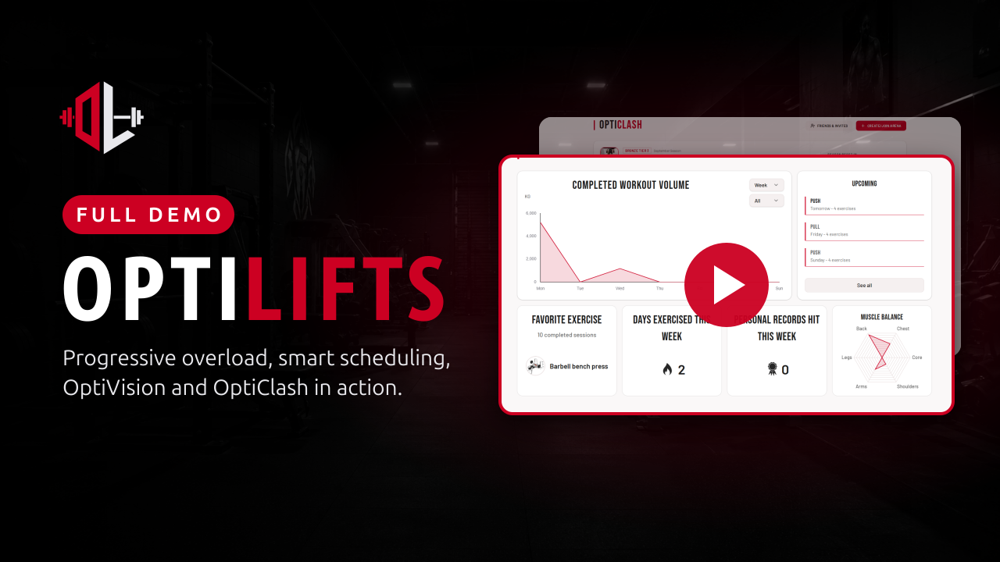
</a>

</div>

<p align="center"></p>

##  The Problem

Traditional fitness applications act as digital notebooks – they record data without ever acting on it. The burden of calculating progressive overload, recovery, and periodisation is placed entirely on the user.

<table width="100%">
  <tr>
    <td width="33%" valign="top">
      <h3 align="center"> Plateau Effect</h3>
      <p align="center">Without a systematic approach to progressive overload, athletes stagnate – going weeks or months without measurable improvement.</p>
    </td>
    <td width="33%" valign="top">
      <h3 align="center"> Rigid Plans</h3>
      <p align="center">Pre-planned routines break down the moment life intervenes. Missed sessions leave users with no guidance on how to recover or adapt.</p>
    </td>
    <td width="33%" valign="top">
      <h3 align="center"> No Context-Awareness</h3>
      <p align="center">Apps ignore fatigue, schedule constraints, and recovery needs – forcing users to make complex athletic science decisions themselves.</p>
    </td>
  </tr>
</table>

<p align="center"></p>

##  How We Solve It

OptiLifts turns your training log into a coach. Instead of just recording what you lifted, it acts on it – every feature below exists to tackle one of those three problems.

<p align="center">
  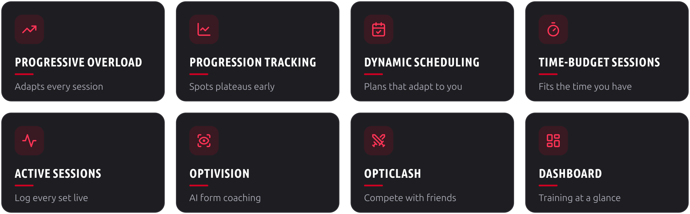
</p>

<details>
<summary><strong>Take the feature tour</strong></summary>
<br>

###  Progressive Overload Engine

The core of OptiLifts. After every session the engine reviews your recent performance and rest days, then updates your next workout – adding weight, adding reps or holding steady – so you keep progressing at a safe, sustainable pace.

<p align="center">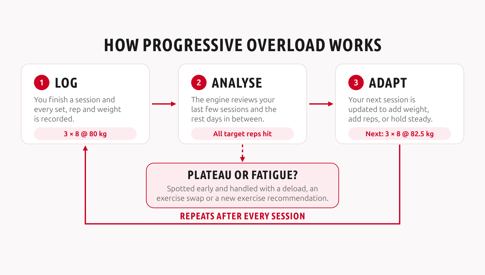</p>

###  Progression Tracking

Every lift is tracked by estimated 1RM against your own 12-week baseline and labelled progressing, plateaued or regressing. Stalled exercises can be swapped for a suitable alternative straight from the Progression page.

<p align="center">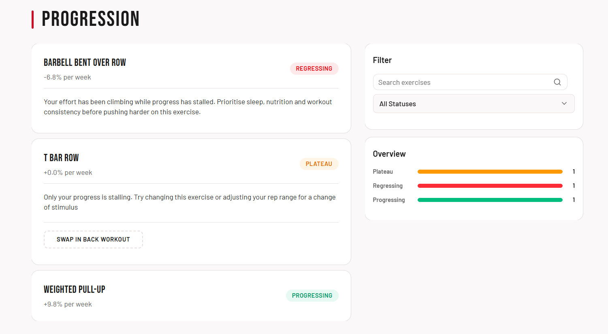</p>

###  Dynamic Scheduling

Missed a session? The scheduler re-slots it around your fixed rest days, daily workout limit and 48-hour muscle recovery, escalating to a Google OR-Tools constraint solver when several sessions need rearranging. Your plan can sync straight to Google Calendar.

<p align="center">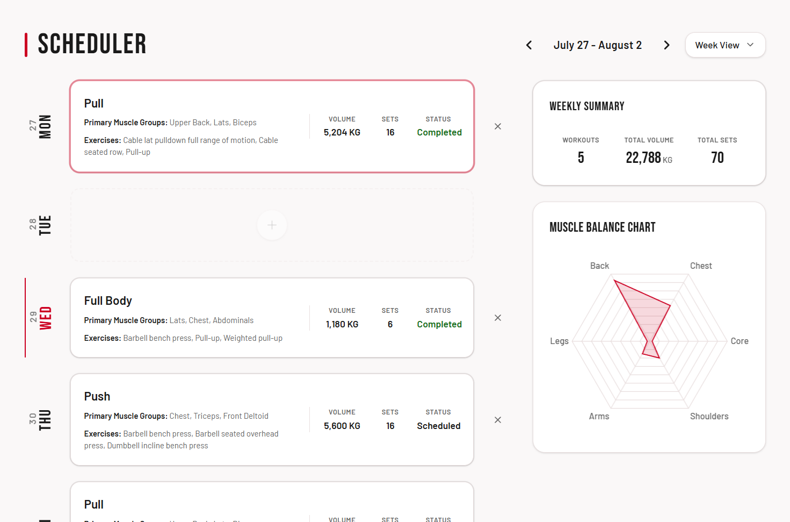</p>

###  Active Sessions

Log weight, reps and RPE set by set as you train, add or remove exercises on the fly, and fit the whole workout into a 15, 30, 45 or 60-minute time budget when you're short on time.

<p align="center">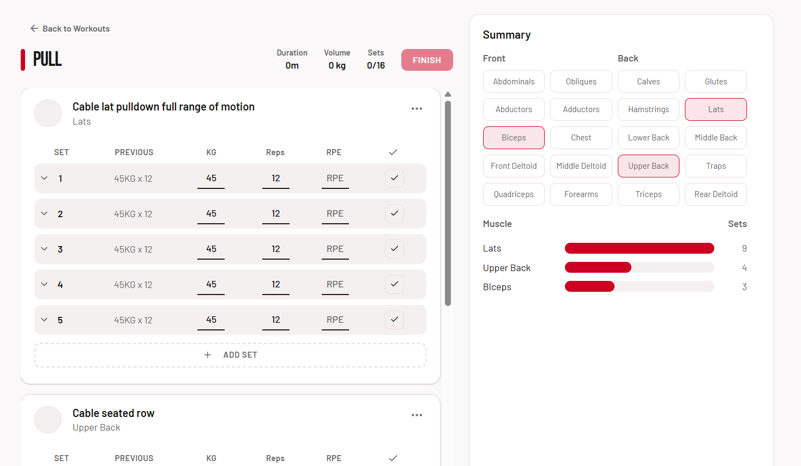</p>

###  OptiVision

Record or upload a squat, bench or deadlift and get computer-vision form analysis: joint angles, rep quality, a form score and coaching tips on what to fix.

<p align="center">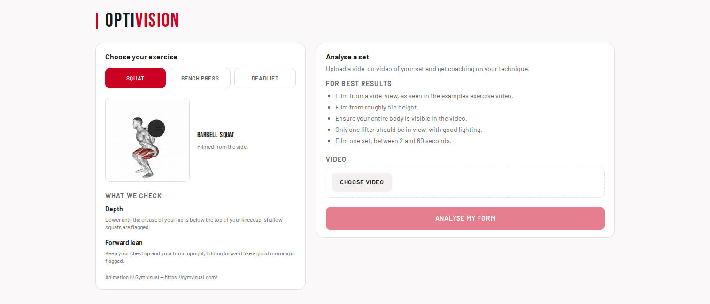</p>

###  OptiClash

Turn training into competition – challenge friends to 1v1 progressive overload duels, build private gym arenas and climb DOTS-ranked leagues from Bronze to Diamond.

<p align="center">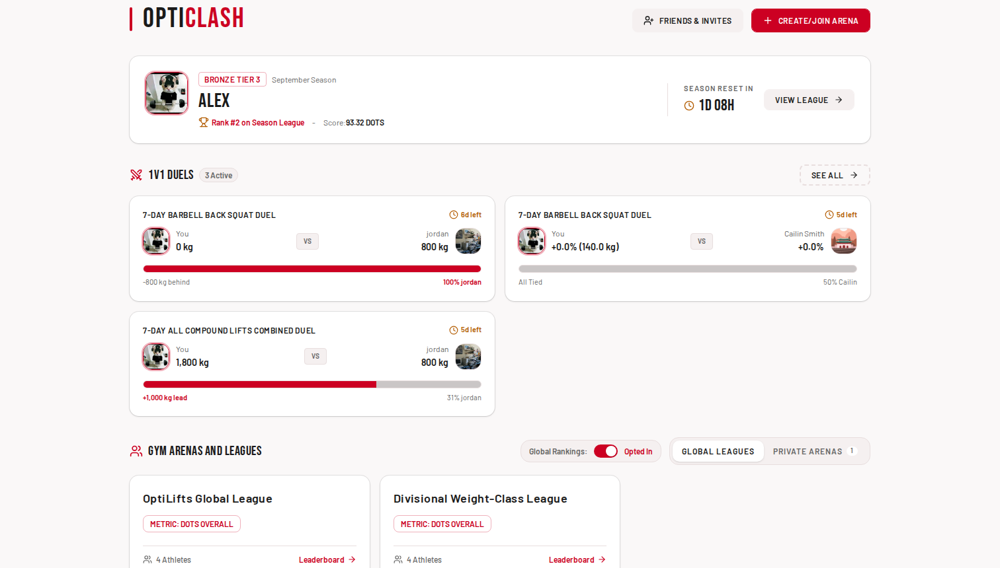</p>

###  Dashboard

Your training at a glance: completed volume, upcoming workouts, favourite exercise, weekly PRs and a muscle balance chart.

<p align="center">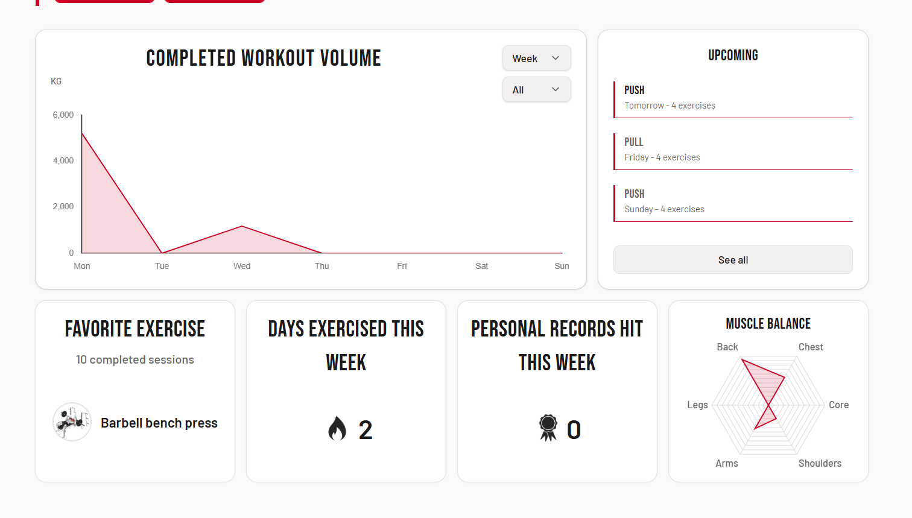</p>

</details>

<p align="center"></p>

##  Tech Stack

| **Component** | **Technology** | **Description** |
| :--- | :--- | :--- |
| **Frontend** |  | React SPA with React Router, built and bundled by Vite with PWA support. |
| **Core API** |  | ASP.NET Core with EF Core and MediatR for clean CQRS-style command/query handling. |
| **AI Backend** |  | FastAPI service |
| **Cloud Hosting** |  | Microsoft Azure – App Service, Container Registry, and managed PostgreSQL. |
| **IaC** |  | Pulumi for defining and provisioning all Azure infrastructure as code. |
| **CI/CD** |  | GitHub Actions pipelines for automated testing, linting, and deployment. |
| **Containerisation** |  | Docker Compose for local development orchestration of all services. |
| **Database** |  | PostgreSQL for structured relational data storage. |
| **Testing** |    | Vitest for frontend unit tests, xUnit and Pytest for backend tests, Moq and Testcontainers for integration tests, Playwright for end-to-end tests. |

<p align="center"></p>

##  The Team

<p align="center">Team Hatrock – five athletes, one codebase.</p>

<br>

<!-- Row 1: Jordan + Cailin centred at same card width as row 2 -->
<table width="100%">
  <tr>
    <td width="17%"></td>
    <td width="33%" align="center" valign="top">
      <br>
      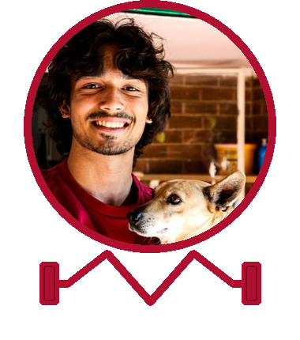
      <br><br>
      <strong>Jordan Naidoo</strong><br>
      <br>
      <sub>A final-year BSc Computer Science student focused on the leadership of the OptiLifts team, spearheading DevOps and getting his bench PR up for project day.</sub>
      <br><br><br>
      <a href="https://github.com/JordanNaidoo"></a>&nbsp;
      <a href="https://www.linkedin.com/in/jordan-naidoo/"></a>
      <br><br>
    </td>
    <td width="33%" align="center" valign="top">
      <br>
      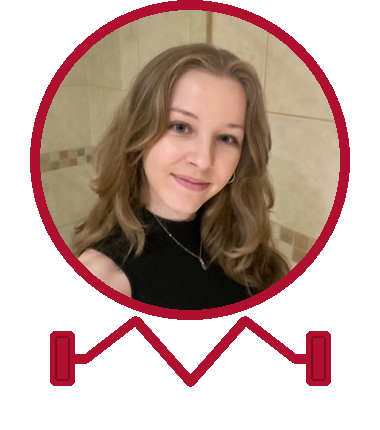
      <br><br>
      <strong>Cailin Smith</strong><br>
      <br>
      <sub>Final-year BSc Computer Science student coordinating frontend development and design for OptiLifts. Best 1RM: 160kg calf raise.</sub>
      <br><br><br>
      <a href="https://github.com/CailinSmith"></a>&nbsp;
      <a href="https://www.linkedin.com/in/cailin-smith-cc1307/"></a>
      <br><br>
    </td>
    <td width="17%"></td>
  </tr>
</table>

<!-- Row 2: Alex + Edwin + Alessandro -->
<table width="100%">
  <tr>
    <td width="33%" align="center" valign="top">
      <br>
      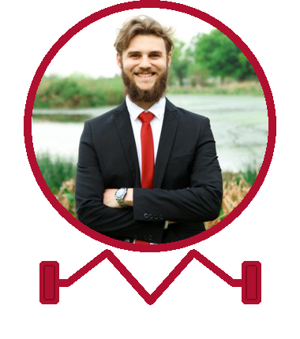
      <br><br>
      <strong>Alex Lange</strong><br>
      <br>
      <sub>A 3rd year BSc Computer Science student with a focus on backend development for OptiLifts, and a lack of backend development in the gym.</sub>
      <br><br><br>
      <a href="https://github.com/AlexLange1st"></a>&nbsp;
      <a href="https://www.linkedin.com/in/alex-lange-7444b8358/"></a>
      <br><br>
    </td>
    <td width="33%" align="center" valign="top">
      <br>
      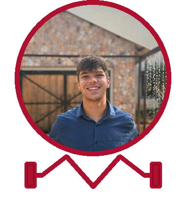
      <br><br>
      <strong>Edwin Küsel</strong><br>
      <br>
      <sub>Final-year Computer Science student, focused on backend, with a passion for problem solving and hitting PRs.</sub>
      <br><br><br><br>
      <a href="https://github.com/EdwinKusel1"></a>&nbsp;
      <a href="https://www.linkedin.com/in/edwin-k%C3%BCsel-642b762a2/"></a>
      <br><br>
    </td>
    <td width="33%" align="center" valign="top">
      <br>
      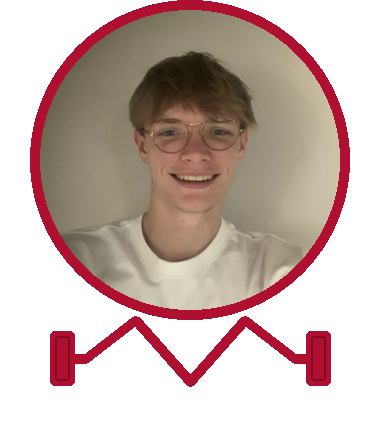
      <br><br>
      <strong>Alessandro Paravano</strong><br>
      <br>
      <sub>Final-year BSc Computer Science student handling frontend development for OptiLifts. Skips leg day in the gym, never skips a sprint.</sub>
      <br><br><br>
      <a href="https://github.com/AlessandroParavano"></a>&nbsp;
      <a href="https://www.linkedin.com/in/aleparavano"></a>
      <br><br>
    </td>
  </tr>
</table>

<p align="center"></p>

##  Documentation

<details open>
<summary><strong>Demo 4 Documentation</strong></summary>
<br>

<div align="center">

[](docs/demo-4/SRS.md)
[](docs/demo-4/SAS.md)
[](docs/demo-4/CODING_STANDARDS.md)
[](docs/demo-4/TESTING_POLICY.md)
[](docs/demo-4/User-Manual.pdf)
[](docs/brand-style/demo4-brandstyle.pdf)
[](https://www.figma.com/site/xHXj3tG6pv2UuKHFgeug8s/OptiLifts--Copy-?node-id=0-1&p=f)
[](https://drive.google.com/file/d/1F_SYfZ7BmbSRSP3FV9RpjjLI6nzJbazQ/view?usp=sharing)

</div>

</details>

<details>
<summary><strong>Demo 3 Documentation</strong></summary>
<br>

<div align="center">

[](docs/demo-3/SRS.md)
[](docs/demo-3/SAS.md)
[](docs/demo-3/CODING_STANDARDS.md)
[](docs/demo-3/TESTING_POLICY.md)
[](docs/demo-3/User_Manual.pdf)
[](docs/brand-style/demo3-brandstyle.pdf)
[](https://www.figma.com/site/xHXj3tG6pv2UuKHFgeug8s/OptiLifts--Copy-?node-id=0-1&p=f)
[](https://drive.google.com/file/d/1yKSPtSmVicaUzwDjMS1FbkR9pfRA02Dt/view?usp=sharing)

</div>

</details>

<details>
<summary><strong>Demo 2 Documentation</strong></summary>
<br>

<div align="center">

[](docs/demo-2/SRS.md)
[](docs/demo-2/SAS.md)
[](docs/demo-2/CODING_STANDARDS.md)
[](docs/demo-2/TESTING_POLICY.md)
[](docs/demo-2/USER_MANUAL.md)
[](docs/brand-style/demo2-brandstyle.pdf)
[](https://www.figma.com/site/xHXj3tG6pv2UuKHFgeug8s/OptiLifts--Copy-?node-id=0-1&p=f)
[](https://drive.google.com/file/d/12TJSUHY3y4JbYCnAiYqEtXsefK5O9UKF/view?usp=sharing)

</div>

</details>

<details>
<summary><strong>Demo 1 Documentation</strong></summary>
<br>

<div align="center">

[](docs/demo-1/SRS.md)
[](docs/demo-1/DESIGN.md)
[](docs/brand-style/demo1-brand-style.pdf)
[](docs/demo-1/REPO.md)
[](https://github.com/orgs/COS301-SE-2026/projects)
[](https://drive.google.com/file/d/1My1plbRG86EpTqbXTdhLJthhue0KC19o/view?usp=sharing)

</div>

</details>

<p align="center"></p>

##  Getting Started

<details open>
<summary><strong>1. Install Prerequisites</strong></summary>
<br>

Make sure you have Node, pnpm, .NET 8, Python 3.12, and Docker installed.

```bash
sudo apt-get install -y nodejs npm dotnet-sdk-8.0 python3 python3-venv python3-pip docker.io
sudo npm install -g pnpm
```

</details>

<details>
<summary><strong>2. Create your .env file</strong></summary>
<br>

Create a `.env` file in the root of the repo with the following values:

```env
POSTGRES_HOST=localhost
POSTGRES_PORT=5432
POSTGRES_DB=optilifts
POSTGRES_USER=postgres
POSTGRES_PASSWORD=your_password_here
JWT_SECRET=your_jwt_secret_here
JWT_EXP_MINUTES=1440
DB_ENCRYPTION_KEY=your_base64_32_byte_key_here
GOOGLE_CLIENT_ID=your_google_client_id
GOOGLE_CLIENT_SECRET=your_google_client_secret
GEMINI_API_KEY=your_gemini_api_key
```

</details>

<details>
<summary><strong>3. Install Dependencies</strong></summary>
<br>

Installs all Node modules, restores C# packages, installs the EF Core CLI, and builds the Python virtual environments for the AI API and OptiVision:

```bash
pnpm run setup
```

</details>

<details>

<summary><strong>4. Run the Application</strong></summary>
<br>

You can run the system locally on your machine or via Docker.

**Option A: Local Development**
```bash
pnpm dev
```
Starts the Docker containers (PostgreSQL, Redis, Azurite), the frontend, the .NET Core API and the Python AI API all at once. The app runs at http://localhost:5173.

**Option B: Docker Development**
```bash
pnpm prod
```
Builds and runs the full stack in Docker Compose. The app runs at http://localhost:5173. Stop it with `pnpm prod:down`.

**Optional: OptiVision worker**
```bash
pnpm start:worker:node
```
Runs the form-analysis worker locally (or `pnpm start:worker:node:docker` to run it in Docker).

</details>

<details>

<summary><strong>5. Demo Data</strong></summary>
<br>

The Core API seeds the database automatically on startup: demo accounts, exercises, and workout history for the demo athletes. To reset everything back to the seeded state, wipe the database volume and start again:

```bash
pnpm db:down:clean
pnpm dev
```

</details>

<p align="center"></p>

##  Commands

<details>
<summary><strong>View all commands</strong></summary>
<br>

| Command | What it does |
| :--- | :--- |
| `pnpm run setup` | Installs Node packages, .NET packages, the EF Core CLI, and the Python virtual environments |
| `pnpm dev` | Starts the Docker containers, frontend, .NET Core API, and Python AI API all at once |
| `pnpm prod` | Builds and runs the full stack in Docker Compose |
| `pnpm prod:down` | Stops and removes the Docker Compose stack (`prod:down:clean` also wipes volumes) |
| `pnpm build` | Builds the frontend and the .NET backend |
| `pnpm db` | Starts the local PostgreSQL, Redis, and Azurite containers |
| `pnpm db:stop` / `pnpm db:start` | Pauses / resumes the local containers without removing them |
| `pnpm db:down` | Stops and removes the local containers |
| `pnpm db:down:clean` | Stops containers and wipes the database volume (the next start re-seeds it) |
| `pnpm db:sync` | Applies the EF Core migrations to your local database |
| `pnpm start:worker:node` | Runs the OptiVision form-analysis worker locally |
| `pnpm test` | Runs the frontend, backend, and AI API unit tests |
| `pnpm test:coverage` | Runs all unit tests with coverage collection |
| `pnpm test:e2e` | Spins up the Docker stack and runs the Playwright end-to-end tests (`test:e2e:ui` for the interactive runner) |
| `pnpm lint` / `pnpm lint:fix` | Lints (and auto-fixes) the frontend, backend, AI API, and OptiVision |

</details>

<p align="center"></p>

##  Acknowledgements

- **EPI-USE** – our industry client, for the vision behind OptiLifts
- The open-source community for the incredible tools and libraries that make this possible
- Microsoft Azure for Students sponsorship
- **Gym Visual** – for the comprehensive exercise media assets. © Gym visual – https://gymvisual.com/

> **Academic Disclaimer:** OptiLifts is strictly a non-commercial Capstone project developed by Team hatrock. All exercise media is strictly used for educational purposes.

<p align="center"></p>
